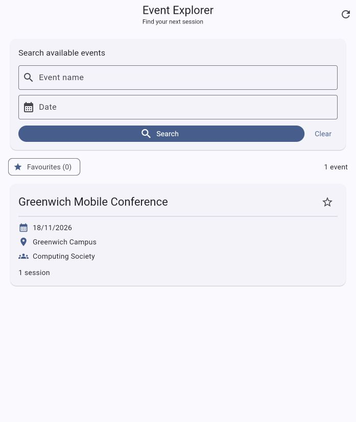
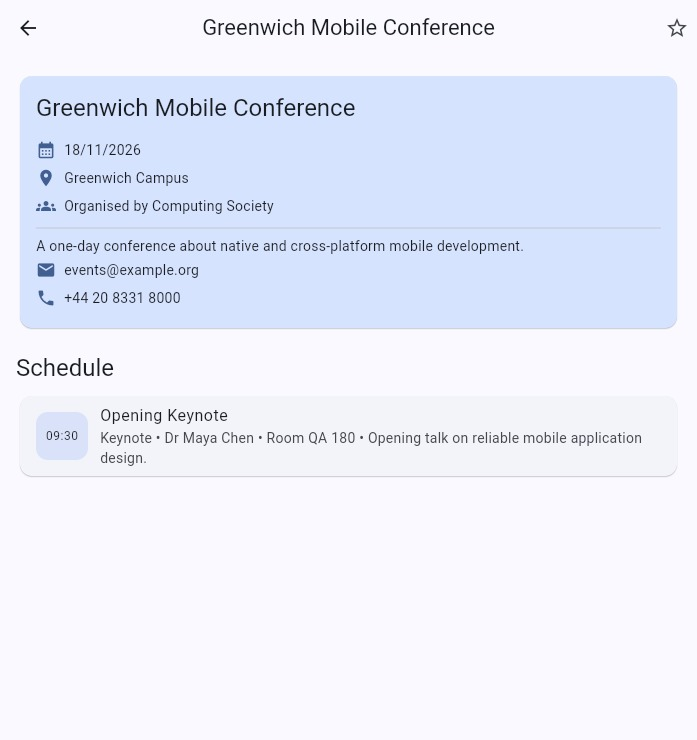

# COMP1786 Event Manager coursework

This repository contains the complete runnable coursework implementation: a native Kotlin Android administration app, a persistent shared web service, a Flutter hybrid attendee app, and the separate Exercise 1 Java BMI Calculator.

See [`COURSEWORK_FEATURES.md`](COURSEWORK_FEATURES.md) for the A-H requirement mapping.

## 1. Start the shared service

Node.js 22 or newer is recommended. The service has no third-party runtime packages.

```text
cd cloud-service
npm test
npm start
```

It starts at `http://localhost:8080`, persists records in `cloud-service/data/events.json`, and provides:

- `GET /health`
- `GET /api/events?name=&date=`
- `PUT /api/events`

Optionally set `ADMIN_API_KEY` to protect writes. A Dockerfile is included for hosted deployment; mount durable storage at `/app/data` and use HTTPS in production.

## 2. Run the native Kotlin admin app

Open the repository root in Android Studio, let Gradle sync, then run the `app` configuration on Android 8.0 (API 26) or newer. The emulator connects to the local service through `http://10.0.2.2:8080/api/events`.

For a hosted service, put these settings in your user `~/.gradle/gradle.properties` (do not commit the secret):

```text
EVENT_API_URL=https://your-service.example/api/events
EVENT_API_KEY=your-secret-key
```

Command-line verification:

```text
./gradlew :app:testDebugUnitTest :app:lintDebug :app:assembleDebug
```

The APK is created at `app/build/outputs/apk/debug/app-debug.apk`.

## 3. Run the Flutter attendee app

```text
cd attendee_app
flutter pub get
flutter run
```

Android emulators use `10.0.2.2`; iOS simulators and web use `localhost`. Override the service for a device or hosted build:

```text
flutter run --dart-define=EVENT_API_URL=https://your-service.example/api/events
```

Verification:

```text
flutter analyze
flutter test --platform chrome
flutter build web
```

## 4. Run the Exercise 1 BMI Calculator

Select the `bmiapp` Android Studio run configuration. It validates kilograms/pounds and centimetres/metres, calculates the adult BMI category, and displays the result in words and colour.

```text
./gradlew :bmiapp:testDebugUnitTest :bmiapp:assembleDebug
```

The APK is created at `bmiapp/build/outputs/apk/debug/bmiapp-debug.apk`.

## Main technologies

- Kotlin, Jetpack Compose, Room (SQLite), WorkManager
- Node.js HTTP service with atomic JSON-file persistence
- Flutter/Dart, Material 3, HTTP, shared preferences
- Java Android Views for the BMI exercise

## Screenshots

| Attendee event list | Event details and schedule |
| --- | --- |
|  |  |

No coursework report or generated PDF is included in this repository.
